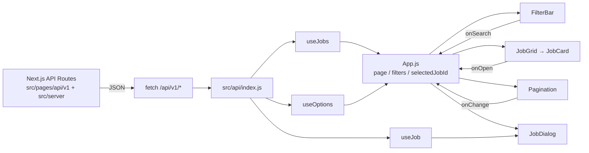

# 架構：文件入口、進入點、Data Flow

## 1. 文件入口（Index）

| 文件 | 內容 |
| --- | --- |
| [SPEC.md](SPEC.md) | 需求規格：功能、API、效能、規範符合度、驗收狀態 |
| [DESIGN.md](DESIGN.md) | 設計規範：顏色、字體、Component |
| [ARCHITECTURE.md](ARCHITECTURE.md)（本文件） | 進入點、目錄、Data Flow、狀態歸屬 |
| [TESTING.md](TESTING.md) | 測試範圍、指令、缺口 |
| [SECURITY.md](SECURITY.md) | 安全性檢查：資料外洩、API 防護、XSS、安全標頭、相依套件、殘餘風險 |
| [PERFORMANCE.md](PERFORMANCE.md) | Lighthouse 跑分、優化內容、寫在測試裡的效能檢查、後續優化 |
| [../CHANGELOG.md](../CHANGELOG.md) | 每次改動紀錄 |
| [../README.md](../README.md) | 題目說明與提交用的執行方式、架構、問題與解法 |

## 2. 程式進入點

| 檔案 | 角色 |
| --- | --- |
| [src/pages/_app.js](../src/pages/_app.js) | Next.js 進入點：以 `router.locale` 建立 `I18nProvider`，由網址前綴決定語言 |
| [src/pages/_document.js](../src/pages/_document.js) | HTML 模板；載入 Noto Sans TC，`<Html>` 依語系自動帶 `lang` |
| [src/pages/index.js](../src/pages/index.js) | 首頁：以 `dynamic(..., { ssr: false })` 載入 `App`（互動頁面只在瀏覽器渲染），載入中顯示 `PageLoader`；輸出各語言的 `<title>`、`hreflang` |
| [src/pages/api/v1](../src/pages/api/v1) | 小後端：`jobs`、`jobs/[id]`、`educationLevelList`、`salaryLevelList` |
| [src/App.js](../src/App.js) | 頁面組裝：`ThemeProvider`、`CssBaseline`、`Hero`、`FilterBar`、`JobGrid`、`Pagination`、延後載入的 `JobDialog`；持有頁面層級狀態 |
| [src/server](../src/server) | 伺服器端資料（50 筆職缺、教育、薪水）與篩選／分頁邏輯；不會被打包進前端 |

## 3. 目錄

| 目錄 | 職責 |
| --- | --- |
| `src/pages` | 頁面與 API Routes |
| `src/server` | 伺服器端資料與邏輯（API 的後端實作） |
| `src/i18n` | 多國語言：`config.js`（語系清單）、`messages/`、`index.js`（`translate`、`I18nProvider`、`useI18n`、`localizeOptions`） |
| `src/api` | 前端 fetch 封裝；唯一知道 URL 與參數命名（`pre_page`、`company_name` 等）的地方 |
| `src/hooks` | 資料取得與狀態：`useJobs`、`useJob`、`useOptions` |
| `src/components` | 純展示與互動元件（含 `Hero`、`PageBackdrop`），不直接呼叫 API（`JobDialog` 透過 `useJob`） |
| `src/theme` | MUI theme（顏色、字型、圓角） |
| `src/assets` | Hero 分層素材（背景、人物、Logo 為 WebP；左右眼為 SVG） |
| `src/figma` | 設計稿截圖（僅供參考，不參與 build） |

## 4. Data Flow

### 4.1 狀態歸屬

| 狀態 | 位置 | 說明 |
| --- | --- | --- |
| `page`、`filters`、`selectedJobId` | `App` | 使用者操作產生的頁面狀態 |
| `pageSize` | `App`（由 `useMediaQuery` 推導） | 桌機 6、手機 4；改變時 `page` 重設為 1 |
| 職缺列表 `jobs`、`total`、`loading`、`loaded`、`error` | `useJobs` | 依 `page`、`pageSize`、`filters` 取得；含快取 |
| 教育／薪水選項 | `useOptions` | 載入一次，供 `FilterBar` 下拉與卡片文字對照 |
| 單一職缺 `job` | `useJob` | `JobDialog` 開啟時依 `jobId` 取得 |
| 輪播目前張數、暫停 | `ImageCarousel` 內部 | 元件私有 |
| 眼珠位移 | `Hero`（CSS 變數） | 不進 React state，避免重繪 |

### 4.2 流程

1. **首次載入**：`App` 渲染 → `useOptions` 取得選項、`useJobs` 取得第 1 頁；`loaded` 為 false 時 `JobGrid` 顯示 Skeleton。
2. **搜尋**：`FilterBar` 按「條件搜尋」→ `onSearch` → `App` 更新 `filters` 並將 `page` 設為 1 → `useJobs` 重新取得；期間保留舊資料並淡化。
3. **換頁**：`Pagination.onChange` → `App` 更新 `page` 並捲回列表頂端 → `useJobs`：命中快取則直接顯示，否則請求；前一個未完成的請求以 `AbortController` 取消。
4. **查看細節**：`JobCard` 按鈕 → `onOpen(id)` → `App` 設定 `selectedJobId` → 動態載入 `JobDialog` → `useJob` 請求單一職缺 → 顯示輪播與淨化後的內容。
5. **關閉**：`onClose` → `selectedJobId` 設為 null。
6. **失敗**：`useJobs` 設 `error`，`JobGrid` 顯示訊息與「重新載入」→ `retry` 重新請求。

### 4.3 API 與欄位對應

| 畫面 | 來源 |
| --- | --- |
| 卡片 公司名稱／職稱／預覽 | `/jobs` 的 `companyName`、`jobTitle`、`preview` |
| 卡片 教育程度／薪水 | `/jobs` 的 `educationId`、`salaryId`，對照 `/educationLevelList`、`/salaryLevelList` 的 `label` |
| 下拉選單選項 | `/educationLevelList`、`/salaryLevelList` |
| 總頁數 | `/jobs` 的 `total` ÷ `pageSize` 無條件進位 |
| Popup 圖片／內容 | `/jobs/:id` 的 `companyPhoto`、`description` |

## 5. 多國語言（i18n）

| 項目 | 說明 |
| --- | --- |
| 語系 | `zh-TW`（預設）、`en`、`ja`，使用 BCP 47 語言標籤；設定於 `next.config.js` 的 `i18n` 與 `src/i18n/config.js`（測試檢查兩處一致） |
| 網址 | `/`（繁中）、`/en`、`/ja`；由 Next.js 內建 i18n 路由處理 |
| 自動偵測 | 進入 `/` 時依 `Accept-Language` 導向最適合的語系（瀏覽器標頭 `en-US,en;q=0.9` → `/en`、`ja-JP,ja;q=0.9` → `/ja`）；以 `NEXT_LOCALE` cookie 記住；不支援的語言（如 `fr`）維持繁中。Next.js 以語言標籤比對，因此標頭只有單一地區標籤（例如只送 `en-US`）時不會自動導向，但手動輸入 `/en` 一樣可用；主流瀏覽器都會同時送出基本語言（`en`） |
| 文字 | `src/i18n/messages/*.js`，三種語言鍵值一致（測試檢查），支援 `{name}` 插值；缺少時回退預設語言 |
| API 選項 | 教育程度、薪水範圍以 id 對照翻譯（`education.4`、`salary.2`…），沒有對應翻譯時使用 API 的 label |
| 內容 | 職缺內容（公司、職稱、說明）來自 API，維持原文 |
| 元件 | 一律透過 `useI18n()` 取得 `t`；沒有 Provider 時退回繁中（方便測試） |
| 輔助 | `<html lang>` 隨語系更新；`hreflang` alternate link；分頁 aria-label 也已翻譯；畫面不提供語言選單（語言由網址前綴與瀏覽器偵測決定） |
